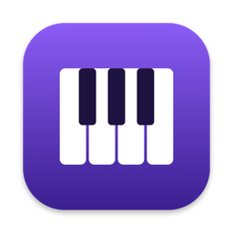

# Constant

A macOS menu bar host for virtual instruments. It keeps one Audio Unit instrument (Omnisphere, Keyscape, Arturia and so on) loaded and playable from your MIDI keyboard, without opening a DAW.

## Features

- Lives in the menu bar, with no Dock icon
- Left click shows or hides the plugin's own editor
- Audio keeps running while the editor is hidden
- The selected plugin and its patch are restored on launch
- Global hotkey or MIDI command (note, CC or program change) to show or hide the editor
- Listens on all MIDI inputs, or only the ones you pick
- Selectable output device, output channel pair and buffer size
- Start at Login

## Requirements

- macOS 13 or later
- Xcode Command Line Tools (`xcode-select --install`)
- Instruments installed as Audio Units. VST is not supported.

## Build

```sh
./build.sh
open build/Constant.app
```

The script builds with SwiftPM, assembles `build/Constant.app` and signs it ad hoc. Full Xcode is not needed.

For daily use, copy `build/Constant.app` to `/Applications`. Start at Login points at the app's location, so enable it from the copy you actually run.

## Usage

| Action | Result |
| --- | --- |
| Left click the icon | Show or hide the plugin editor |
| Right click the icon | Instrument, Settings, About, Quit |

**Instrument** picks the plugin to host, grouped by manufacturer. Switching plugins discards the previous plugin's patch.

**Settings** has three tabs:

- **General** - Start at Login, where the editor appears (Top Right, Top Left, Center, Bottom Left or Bottom Right), and the show/hide shortcuts: a global hotkey or a learned MIDI command. The learned MIDI message is not passed on to the instrument.
- **Audio** - output device, output channel pair (on devices with more than two outputs) and buffer size.
- **MIDI** - all inputs, or individual devices.

## Notes

- Plugins load inside the app's process, so a plugin crash also quits Constant.
- The app is not sandboxed and is signed ad hoc, which is what lets third-party Audio Units load. It is meant to be built and run locally, not distributed through the Mac App Store.
- The session is saved to `~/Library/Application Support/Constant/session.plist`.

## Project layout

| File | Role |
| --- | --- |
| `InstrumentHost.swift` | Audio engine, plugin loading, session save and restore |
| `PluginPanelController.swift` | The panel that shows the plugin editor |
| `StatusItemController.swift` | Menu bar icon, context menu, Settings window |
| `MIDIInput.swift` | MIDI device handling and message forwarding |
| `ToggleShortcuts.swift` | Global hotkey and MIDI show/hide trigger |
| `AudioDevices.swift` | Output device listing and buffer size |
| `SettingsView.swift` | Settings UI |

All sources are in `Sources/Constant/`.
